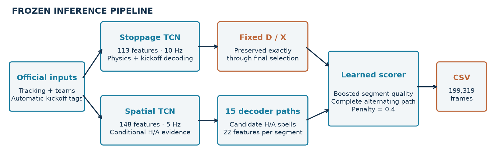
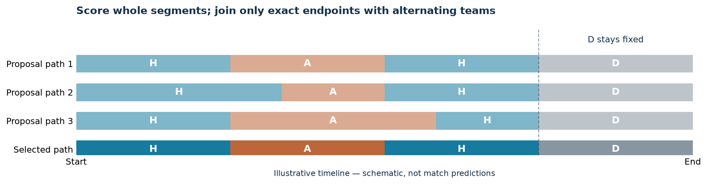

# Absolute Donut: Possession Recognition with Learned Spell Scoring

**Team:** Absolute Donut

**Authors:** Eduardus Tjitrahardja, Louis Jefferson Zhang, Stuart Davis Tioniwar, Joel Van Doli Marpaung

## Abstract

We estimate team possession and stoppages from automatic football tracking by combining temporal classification with learned selection of complete possession segments. An aggregate temporal convolutional network (TCN) determines stoppage intervals. A spatial TCN estimates the controlling team during live play. Fifteen alternative decoded paths generate candidate segments, which a gradient-boosted regressor scores using temporal confidence, agreement and physical-control evidence. Dynamic programming selects a continuous sequence of alternating possessions while preserving stoppage boundaries. The submitted system achieves 0.656968 source-balanced nested external spellF1 and 0.720000 spellF1 on the official public window.

## 1. Problem formulation and input representation

For each tactical-video frame t, we predict y(t) in {H, A, D, X}, denoting home-team control, away-team control, dead ball and ungraded frames. The output contains 199,319 rows at 25 Hz with zero-based frame indices. The official tracking export supplies normalized two-dimensional coordinates for player track slots and the ball. The XML metadata assigns each slot to a team. Coordinates are converted to metres using the supplied pitch dimensions, 105.3 by 68.0 m. A slot represents a tracklet rather than a persistent player identity; features pool slots by team.

The algorithm reads tactical automatic tracking, slot-to-team metadata and automatic kickoff Smart Tags. Published half boundaries determine the graded frame ranges. Computation is performed independently within each half, preventing features and decoding from crossing halftime. Missing coordinates are retained as unavailable observations and are represented explicitly in each network's inputs. The system is offline and uses past and future context.

## 2. Method

The inference pipeline has two temporal branches. The first estimates live/dead status; its dead-ball intervals remain fixed. The second estimates conditional home/away control on the remaining frames. A segment-scoring model combines several candidate control sequences into the final prediction.

### 2.1. Aggregate tracking features for stoppage estimation

We construct 113 scalar features per frame from ball position, player-to-ball distances, team membership and coordinate differences over time. These are aggregate summaries of the available objects rather than one feature vector per identified player. For player i and ball b, proximity is the Euclidean distance between their metric coordinates. Team proximity features sort these distances within each team's available slots. Ball-boundary position is represented by the largest signed excursion beyond the four pitch lines: positive outside and negative inside.

Before this branch's feature extraction, player positions held exactly constant for at least two seconds are marked missing. Short out-and-back spikes of at most 0.2 s are interpolated when their endpoints admit plausible motion. Ball gaps of at most 0.5 s are linearly interpolated only when bounded endpoints imply at most 32 m/s. Observation confidence is 1 for observed ball coordinates, 0.45 for accepted interpolation and 0 otherwise.

For offsets 0.2, 0.6, 1.5 and 4.0 s, speed is displacement divided by elapsed time, computed separately toward the past and future. Ball-speed measurements are unavailable whenever the measurement interval crosses a missing raw observation. Player-speed measurements are unavailable across discontinuous track intervals; finite speeds are capped at 12 m/s before team averaging. Lagged snapshots are obtained by shifting selected features into the past within the same half.

| Feature group | Count | Construction |
| --- | --- | --- |
| Shared ball summaries | 15 | Confidence, signed pitch-boundary excursion and nearest-player distance; for each of four offsets, one local confidence mean and past/future ball speeds: 3 + 4 x 3. |
| Team summaries | 40 | Per team: nearest/second-nearest distances, number within 5 m and observed-slot count; plus nearest-distance snapshots and mean player speed in both directions at four offsets: 2 x (4 + 4 x 2 x 2). |
| Lagged snapshots | 56 | Four past offsets (0.5, 1, 2, 4 s) of 14 signals: confidence, boundary excursion, nearest-player distance, backward 0.2 s ball speed, and each team's four current summaries plus backward 0.2 s mean speed. |
| Raw observation history | 2 | Ball-observed indicator and log(1 + seconds since the last observed ball); unavailable before any observation. |
| Total | 113 | Sampled at 10 Hz after feature construction on the native frame grid. |

A fitted numeric transform preserves feature order and converts the ball-observed column to Boolean; the package includes an exact exported implementation. Each scalar is standardized using stored training statistics and accompanied by its missing-value indicator, yielding 226 network input channels. Unavailable standardized values are zeroed and finite standardized values are clipped to [-8, 8].

### 2.2. Temporal stoppage classification and decoding

A linear projection maps the 226 channels to width 48. Six residual one-dimensional convolutions with kernel width three and dilations 1, 2, 4, 8, 16 and 32 produce three state logits per sample. Gaussian error linear unit activations transform convolution outputs. Softmax converts the logits to H/A/D probabilities. Inference averages the ordinary prediction with a second prediction obtained by exchanging the home/away feature groups and mapping its outputs back to the original team order.

Probabilities are linearly interpolated to the native 25 Hz grid. A Viterbi decoder maximizes accumulated log-probability with turnover cost 5 and live/dead transition cost 10. Evidence is multiplied by 10/fps to preserve the relative transition scale across frame rates. Staying in a state has zero transition cost. Directional physical-control cues adjust turnover cost with strength 2: sustained co-motion near the ball or an uncontested velocity change supports a new controlling team, while a fast ball continuing past a nearby player penalizes a switch. These cues require observed ball-motion windows.

Automatic kickoff tags bound the search for the ball departing the centre spot. Graded frames before the detected kickoff are D, and decoding starts afresh at the detected strike. When tracking cannot resolve the strike, the midpoint of the automatic tag interval is used. Frames outside the published graded half ranges are X. The resulting D/X masks are fixed throughout subsequent processing.

### 2.3. Spatial feature encoding and live-team inference

A second network uses spatial summaries at 5 Hz to estimate the controlling team. Half-wise orientation is normalized by rotating coordinates through 180 degrees when the home team's median longitudinal position lies beyond the away team's. Feature extraction uses the sampled canonical tracking with explicit coordinate missingness; physical-control cues separately use repaired player tracks.

The 148-dimensional representation is built from 49 instantaneous scalars, their one- and three-second centred means, and one training-source indicator. A centred mean divides the sum of finite values by their finite-observation count. An empty window remains missing. Adjacent-frame differences give velocity; unavailable differences and speeds above 45 m/s are masked.

| Feature group | Count | Construction |
| --- | --- | --- |
| Ball geometry and motion | 9 | Normalized x/y, x/y velocity, speed, observation indicator, capped time since/until observation and signed pitch-boundary excursion. |
| Team formation and proximity | 32 | Per team: centroid x/y, x/y spread, 10th/50th/90th position quantiles on both axes, visible count, mean speed, walking share, nearest/second-nearest ball distances and nearby-player count. |
| Touch-history evidence | 8 | Distance-margin-weighted team support, exponentially decaying past/future support, their strengths, ball visibility, and agreement/disagreement across neighbouring control observations. |
| Temporal means | 98 | One- and three-second finite-value means of the preceding 49 instantaneous scalars. |
| Training-source indicator | 1 | Distinguishes auxiliary H/A-only training games from primary games; set to the primary value at submission inference. |
| Total | 148 | Missing-value indicators are appended, producing 296 network input channels. |

A width-96 linear projection feeds seven residual convolutions with kernel width three, dilations 1 through 64, per-frame layer normalization and Gaussian error linear unit activations. The convolutional receptive field extends approximately 25.4 s in each direction. Standardized inputs are clipped to [-10, 10]. The network is trained to predict H/A/D and an auxiliary state-boundary signal. At final inference, only the H/A state probabilities are retained and renormalized to sum to one; the fixed masks determine D/X. We average predictions under ordinary and rotated team-swapped inputs, interpolate to 25 Hz and round to four decimals. One frozen seed-413 network is used.

### 2.4. Candidate possession segments and learned quality

Within each live interval, a two-state Viterbi decoder is run over five turnover costs {0.5, 1, 2.5, 5, 10} and three directional physical-adjustment strengths {0, 1, 2}. The 15 paths produce a union of candidate segments. A segment specifies a start frame, end frame and controlling team. The cost-2.5, zero-adjustment path guarantees that at least one complete path is available through every live interval.

For each candidate, 22 team-symmetric features describe duration; agreement among proposal paths; membership and overlap with the fixed-cost path; within-segment confidence, log-odds and uncertainty; confidence in the two seconds before and after its boundaries; boundary changes in log-odds; ball-observation share; physical-control support for either team; and adjacency to dead ball. Swapping team names preserves these candidate descriptors.

A histogram gradient-boosted regressor predicts candidate quality using 150 boosting iterations, learning rate 0.05, at most 15 leaves, minimum leaf size 40 and L2 regularization 10. For a candidate in an external training game, we find its greatest temporal intersection-over-union (IoU) with a same-team target possession. Temporal IoU is the overlap duration divided by the union duration. Its regression target is the fraction of thresholds {0.3, 0.4, 0.5, 0.6, 0.7} met by that overlap. Candidates intersecting unknown target regions are excluded. Predictions are clipped to [0, 1]; they represent expected overlap-threshold quality rather than a calibrated probability of correctness.

### 2.5. Complete-coverage segment selection

Candidate segments form a directed acyclic graph: an edge joins two segments when their endpoints meet exactly and their teams differ. Dynamic programming selects a path maximizing the sum of candidate quality minus a per-segment penalty of 0.4. Each live interval is decoded independently. Every live frame is covered exactly once, consecutive live possessions alternate teams, and all fixed D/X frames are preserved.

Possession therefore represents sustained team control across passes and loose-ball intervals. A brief proximity change during a challenge is insufficient by itself to force a turnover; the temporal probabilities and complete-segment objective determine whether a switch is supported. Restart timing follows the fixed stoppage boundaries, while the subsequent live team is assigned by the spatial branch and segment selector.

## 3. Training and nested validation

### 3.1. External supervision and optimization

All supervised fitting and parameter selection use external games. SkillCorner labels are derived mechanically from provider possession phases: H/A during a team's phase, D in bracketed within-half gaps for stoppage-model training, and unknown at unsupported endpoints. The aggregate TCN uses 12 A-League training games, four development games for checkpoint selection and four held-out test games. It is trained for eight epochs with synthetic tracking corruption.

The spatial TCN uses seven DFL/IDSSE games with released frame-level possession and ball-status labels, three Metrica sample games with targets derived from synchronized events, and twenty SkillCorner A-League games with H/A supervision. Metrica restart/control events establish team control; compatible stoppage events establish D; ambiguous offside intervals and unexplained gaps remain unknown. SkillCorner frames outside team phases are excluded from spatial supervision. Labels come from dataset providers and mechanical event translation.

Spatial training uses 12 epochs of 50 batches, batch size 12, 768-frame crops and 480 central supervised frames. AdamW uses peak learning rate 0.0005, five-percent warmup, cosine decay, weight decay 0.01 and gradient clipping at 1. Live-state cross-entropy is weighted by the square root of median possession duration divided by each possession's duration, clipped to [1/3, 3]; D frames have weight one. Auxiliary-source sampling is weighted by one quarter. An auxiliary transition loss has coefficient 0.15 and within-state probability smoothing has coefficient 0.05. Augmentation introduces ball/player gaps, smooth ball-position errors and moving dead-ball examples. Unknown target frames receive zero supervised weight.

### Training data

The spatial network uses the following 30 external games. Frame counts refer to the 5 Hz training grid before synthetic augmentation; unknown targets are excluded from the supervised counts.

| Training source | Games | 5 Hz labeled frames | Targets | Use |
| --- | --- | --- | --- | --- |
| DFL/IDSSE Bundesliga | 7 | 200,534 | Released H/A/D | Training and primary cross-validation |
| Metrica sample data | 3 | 83,233 | Event-derived H/A/D | Training and primary cross-validation |
| SkillCorner A-League | 20 | 315,102 | Provider-derived H/A | Auxiliary training only |
| Total | 30 | 598,869 | Mixed supervision | 10 primary + 20 auxiliary |

The aggregate TCN uses the same A-League collection with a 12-game training, four-game development and four-game test split. The final spatial network uses all 20 games for auxiliary training. These rows therefore describe overlapping source games, not additional independent datasets.

### 3.2. Nested external evaluation

The ten primary games are split into five outer folds of two held-out games. For each fold, four inner neural fits exclude both the outer test pair and an inner pair, providing scorer-training predictions for the other eight primary games. Inner models train on six primary games plus the twenty auxiliary games. Leave-one-training-match-out regressor fits choose a segment penalty from {0.2, 0.4, 0.6}. Scorer fitting balances providers and games. The two outer games are excluded from neural normalization, neural fitting, regressor fitting and penalty selection in that fold. The final regressor uses out-of-fold neural predictions for all ten primary games and is paired with the spatial network trained on all thirty external games.

Here, external refers to games other than the competition match, and nested refers to parameter selection inside each outer evaluation split. The scored games are seven DFL/IDSSE Bundesliga matches and three Metrica sample matches. The twenty A-League games are training-only in this benchmark. For each held-out half and tracking condition, spellF1 performs same-team, one-to-one segment matching at IoU thresholds 0.3, 0.4, 0.5, 0.6 and 0.7 and averages the resulting precision/recall F1 scores. We average the two halves and natural/corrupted tracking conditions within each match, then average matches within each provider. The headline score gives the DFL and Metrica means equal weight. It measures segment detection, not frame accuracy. Benchmark reuse during development limits its interpretation as a fresh blind test; neural confidence can also vary with inner, outer and final training sizes.

## 4. Evaluation

### 4.1. Nested external evaluation by dataset

The fixed-cost path uses the same spatial probabilities and fixed stoppages with turnover cost 2.5 and zero directional adjustment; it is also included among the final selector's proposals. All table entries average natural and corrupted tracking conditions. Delta is learned minus fixed-cost spellF1.

| Scored dataset | Matches | Fixed-cost path | Learned | Delta |
| --- | --- | --- | --- | --- |
| DFL/IDSSE Bundesliga | 7 | 0.603497 | 0.612391 | +0.008894 |
| Metrica sample data | 3 | 0.688594 | 0.701545 | +0.012951 |
| Equal-provider mean | 10 | 0.646045 | 0.656968 | +0.010923 |

### 4.2. Nested external evaluation by held-out match

| Held-out game | Fold | Fixed-cost path | Learned | Delta |
| --- | --- | --- | --- | --- |
| DFL J03WMX | 1 | 0.553796 | 0.563632 | +0.009836 |
| Metrica game 1 | 1 | 0.693953 | 0.707874 | +0.013921 |
| DFL J03WN1 | 2 | 0.548318 | 0.562047 | +0.013728 |
| Metrica game 2 | 2 | 0.673600 | 0.690948 | +0.017348 |
| DFL J03WOH | 3 | 0.642699 | 0.664017 | +0.021318 |
| Metrica game 3 | 3 | 0.698228 | 0.705813 | +0.007585 |
| DFL J03WOY | 4 | 0.611768 | 0.621453 | +0.009685 |
| DFL J03WPY | 4 | 0.587799 | 0.594963 | +0.007165 |
| DFL J03WQQ | 5 | 0.631017 | 0.634720 | +0.003702 |
| DFL J03WR9 | 5 | 0.649081 | 0.645902 | -0.003179 |

Learned selection improves nine of ten held-out matches. The source-balanced gain is 0.010923 spellF1. The two provider averages receive equal weight, so the headline score is not the unweighted mean of all ten games.

### 4.3. A-League evaluation of the aggregate TCN component

| Evaluation | Matches | spellF1 | macroF1 | D-F1 |
| --- | --- | --- | --- | --- |
| Development, natural | 4 | 0.706675 | 0.920773 | 0.954828 |
| Test, natural | 4 | 0.670428 | 0.907669 | 0.951230 |
| Test, corrupted | 4 | 0.594520 | 0.869116 | 0.933053 |
| Complete submitted pipeline | 0 held out | N/A | N/A | N/A |

These results evaluate the aggregate TCN checkpoint with its H/A/D decoder at turnover/stoppage costs 5/10. They are component results, not scores for the complete learned-spell submission. Corrupted tests add synthetic tracking gaps. The final spatial network trained on all 20 A-League games, so there is no independent held-out A-League score for the complete submitted pipeline.

### 4.4. Official public evaluation

| Method | spellF1 | macroF1 | Accuracy | Spells | D-F1 |
| --- | --- | --- | --- | --- | --- |
| Competition baseline | 0.325581 | 0.620733 | 0.713200 | 26 | 0.322548 |
| Absolute Donut | 0.720000 | 0.918671 | 0.925600 | 18 | 0.891584 |

The competition baseline is the published `baseline_smooth50.csv`: nearest-player team assignment with a centered 50-frame majority vote. Both files were scored with the same official evaluator on the same 7,500 public frames. The target contains 17 possessions. Our submission improves spellF1 by 0.394419 and macroF1 by 0.297938. D-F1 is dead-ball F1; full-match private performance is unknown.

The public evaluation is performed after freezing model weights and parameters. It is an automated check on 7,500 published frames, not a source of supervision or hyperparameter selection. Scores on the unpublished full match are unavailable.

## 5. Reproduction and limitations

The final package includes both TCN checkpoints, stored normalization, the numeric feature transform, the segment regressor and decoder implementation. Run `python final/reproduce.py --data-dir BUNDLE --device cuda --output OUT.csv` with the pinned dependencies. The verified NVIDIA GB10 / PyTorch 2.15.0+cu132 environment regenerates all 199,319 rows byte for byte. Each run verifies artifact fingerprints, validates CSV structure and checks the complete output SHA-256. CPU inference differed at two H/A frames and therefore failed this exactness check; numerical reproducibility is verified for the documented CUDA environment.

The fixed stoppage mask constrains the selector: errors in its boundaries cannot be corrected by live-team inference. Automatic tracking can contain team-code errors, missing-ball intervals and ambiguous player contacts. Event-derived supervision and provider-specific possession definitions introduce label noise and domain shift. The segment-quality target approximates the final one-to-one metric, and the graph cannot select a boundary absent from its proposal paths. Future context makes the method suitable for offline analysis rather than live deployment.

## References and data attribution

SkillCorner Open Data: twenty A-League games, MIT license; revision `4340d274572876239c154c90bc507a9b3250a656`. https://github.com/SkillCorner/opendata/tree/4340d274572876239c154c90bc507a9b3250a656

DFL/IDSSE: Bassek et al., Scientific Data (2025), CC BY 4.0. Credit to Deutsche Fußball Liga and the dataset authors. https://doi.org/10.1038/s41597-025-04505-y. Data mirror revision `a715a38dfbaf5f58e431727c2b78d174101a703c`: https://huggingface.co/datasets/pysport/idsse-data

Metrica Sports Sample Data: three games; credit to Metrica Sports for the tracking and events. Revision `e706dd506b360d69d9d123d5b8026e7294b13996`. https://github.com/metrica-sports/sample-data/tree/e706dd506b360d69d9d123d5b8026e7294b13996
